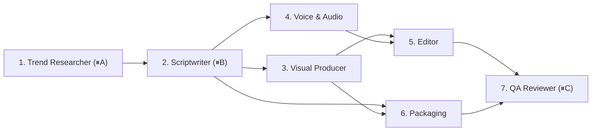

# Moderator — Reusable Multi-Agent Workflow Engine + Live Dashboard

A domain-agnostic Python orchestrator (`moderator/engine/`) powered by **Google Gemini Flash + Nano Banana** that schedules DAGs of specialist agents in parallel, tracks every step in a single atomic `state.json`, pauses at human checkpoints, retries failures with escalating strategies, routes QA or human revision feedback upstream, and serves a live single-page web dashboard.

The flagship workflow (`workflows/youtube_short.yaml`) produces vertical **9:16 YouTube Shorts** (<60s, target 34–44s) in any combination of **English (`en`)**, **French (`fr`)**, and **Egyptian Arabic (`ar`)**, stopping for human approval at idea selection, script review, and final QA before anything is ever uploaded.

---

## Recommended Gemini Stack (Single `GEMINI_API_KEY`)

| Capability | Default Alias | Primary Model | Automatic Fallback | Used By |
|---|---|---|---|---|
| **Reasoning, JSON & Web Search** | `flash` | `gemini-3.8-flash` | `gemini-3-flash-preview` → `gemini-2.5-flash` | `trend_researcher`, `scriptwriter`, `packaging`, `qa_reviewer`, `niche_scout` |
| **Native 9:16 Visuals & Thumbnails** | `banana` | `gemini-nano-banana-2.1` *(Nano Banana 2.1)* | `gemini-3.1-flash-image` → `gemini-2.5-flash-image` | `visual_producer` (`nano_banana` tier), `packaging` (`banana_thumbnail` tier) |

---

## Architecture

```
workflows/*.yaml          Declarative DAGs (steps, depends_on, checkpoints, params)
agents/<name>/            Self-contained specialist agents (agent.yaml + handler.py)
moderator/
  engine/
    workflow.py           YAML loader, cycle & checkpoint validation, topological sort
    state.py              Thread-safe StateStore with atomic state.json persistence
    orchestrator.py       Async parallel scheduler, strategy retries, revision routing
    agent.py              Agent base class + StepContext (progress, logs, cost, choices)
    registry.py           Dynamic agent & workflow discovery from disk
    llm.py                Gemini Flash (text/JSON/Google Search) + Nano Banana (9:16 images)
  server/app.py           FastAPI server sharing the engine's asyncio event loop
  dashboard/              Zero-dependency SPA (3s live polling, SVG DAG, drawer, dark/light)
  tools/                  Shared utilities (ffmpeg/ffprobe, edge-tts, Pexels/Pixabay, ASS/RTL text)
runs/<run_id>/state.json  Single source of truth for each workflow run
```

### Adding a New Workflow (Zero Engine Changes)
1. Create agent folders under `agents/<agent_name>/` (`agent.yaml` + `handler.py` implementing `class Handler(Agent)`).
2. Add `workflows/<workflow_name>.yaml` declaring `steps`, `depends_on`, and optional `checkpoint` blocks.
3. Run `python -m moderator run <workflow_name>`.

---

## YouTube Short Agent Team (`workflows/youtube_short.yaml`)



| # | Agent | Role | Strategies (Retry Escalation) | Outputs |
|---|---|---|---|---|
| 1 | `trend_researcher` | Finds 3 ranked video ideas, <3s hooks, keywords & sources via Gemini Flash + Google Search | `web_and_youtube` → `web_only` → `no_web` | `ideas.json`, `ideas.md` |
| 2 | `scriptwriter` | Writes 34–44s scene-by-scene script with <2.5s hook and looping ending & on-screen text | `default` → `tighter_word_budget` → `simpler_structure` | `script.json`, `script.md` |
| 3 | `visual_producer` | Generates custom 9:16 visuals with Nano Banana (or stock/procedural fallback) + licenses | `nano_banana` → `stock_video` → `stock_photo` → `generated` | `assets/scene_XX.mp4`, `assets/licenses.json` |
| 4 | `voice_audio` | Synthesizes neural voiceover + word timings, ambient music & SFX | `primary_voice` → `alternate_voice` → `third_voice_slower` | `voiceover_<lang>.mp3`, `music.mp3`, `sfx/whoosh.mp3` |
| 5 | `editor` | Cuts scenes to narration, adds `xfade` transitions, ASS captions & `-14 LUFS` mix | `transitions` → `hard_cuts` → `hard_cuts_no_sfx` | `final_short_<lang>.mp4`, `captions_<lang>.ass` |
| 6 | `packaging` | Writes native SEO metadata + designs 9:16 Nano Banana thumbnail | `banana_thumbnail` → `frame_thumbnail` → `plain_thumbnail` | `metadata.json`, `thumbnail_<lang>.png` |
| 7 | `qa_reviewer` | Verifies duration, hook timing, 9:16, LUFS, caption sync, licenses & spelling; routes fixes back | `full_review` → `full_review` → `technical_only` | `qa_report.json`, `qa_report.md` |

---

## Quickstart

```sh
# 1. Install dependencies & set GEMINI_API_KEY in .env
cp .env.example .env
uv sync

# 2. Try the offline demo workflow (exercises parallel steps, retries, revisions & checkpoints)
uv run python -m moderator run demo

# 3. Run YouTube Short in English + French (opens live dashboard at http://127.0.0.1:8765)
uv run python -m moderator run youtube_short -p 'languages=[en, fr]' -p topic="Why we remember embarrassing moments"

# 4. Single-language English run with a $1.50 budget cap (or `-p visual_mode=stock` to prefer stock video)
uv run python -m moderator run youtube_short -p languages=en -p budget_usd=1.50

# 5. Resume an interrupted run (and optionally requeue failed steps)
uv run python -m moderator resume runs/<run_id> --retry-failed

# 6. Run test suite
uv run pytest -q
```

---

## GitHub Actions & YouTube Publishing

- **[`generate-short.yml`](.github/workflows/generate-short.yml)** runs on schedule (twice daily) or manually via **Run workflow**, renders the Short(s), uploads the MP4/thumbnail artifact, and opens a `short-review` GitHub Issue.
- **[`upload-short.yml`](.github/workflows/upload-short.yml)** publishes to your YouTube channel **only** when you comment `/approve`, `/approve unlisted`, or `/approve public` on that review issue (or trigger the workflow manually).
- Supports **one YouTube channel** (`YOUTUBE_TOKEN`) or **separate channels per language** (`YOUTUBE_TOKEN_EN`, `YOUTUBE_TOKEN_FR`, `YOUTUBE_TOKEN_AR`). Full setup guide: **[`docs/SETUP.md`](docs/SETUP.md)**.
